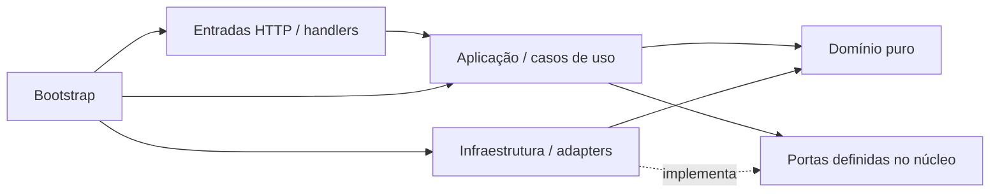
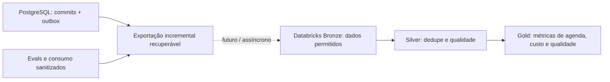

# Arquitetura DDD da plataforma

Estado: decisão de organização aceita para a implementação; aplicação ainda não iniciada.
Fonte normativa: [spec](../../spec.md). Execução incremental: [Kanban](../jira-pessoal/KANBAN-OFICIAL.md).

## Decisão e referência do WorkLink

Adotar monólito modular com DDD e portas e adaptadores, mantendo API e worker.
Do WorkLink aproveitamos a separação entre domínio, aplicação, entradas e infraestrutura,
descrita em seu ADR-0001 e guia de backend modular hexagonal. Aqui a estrutura começa
pelo contexto de negócio, com camadas internas Python conforme a necessidade da história.

DDD organiza linguagem, responsabilidade e invariantes. Ports and Adapters protege essas
regras de FastAPI, persistência e providers. Uma pasta ou um serviço externo não constitui,
por si só, um bounded context; as fronteiras abaixo são a baseline e podem ser revistas
com evidência de negócio. Não exigem deployments separados.

## Unidade de repositório, aplicação e release

Frontend, backend, testes, migrations, documentação e automação ficam neste mesmo
repositório. A plataforma é um monólito modular: módulos de negócio são pacotes internos,
integrados por contratos públicos e chamadas locais. Não criar API HTTP, repositório,
pipeline de publicação ou banco independente para cada contexto.

API e worker são entradas de execução da mesma aplicação, compartilham código e versão
e usam a mesma imagem de runtime, com comandos de inicialização distintos. O worker
pode ter quantidade de processos própria para jobs; isso não separa o domínio em serviços.
O artefato da plataforma inclui os assets do frontend, servidos pela aplicação. Se D-12
escolher toolchain de frontend, seu build é uma etapa do mesmo ciclo de entrega; não
exige servidor frontend separado em produção. Ferramenta de desenvolvimento com hot reload
pode ser usada localmente, sem alterar a topologia de publicação.

Organização de repositório planejada, sem gerar diretórios antes das histórias:

```text
repositório/
├── frontend/       # chat: componentes, funcionalidades e cliente dos contratos HTTP
├── src/clinic_ai/  # aplicação Python e módulos de domínio descritos abaixo
├── tests/         # testes de domínio, integração, jornadas e fronteiras
├── migrations/    # sequência ordenada, com propriedade por contexto
├── docs/          # especificação, histórias, decisões e evidências
├── scripts/       # automação e harness
└── .github/       # CI/CD da plataforma e contratos do harness
```

D-12 detalha os subdiretórios de `frontend` conforme a stack escolhida: componentes
visuais reutilizáveis, funcionalidades de conversa/sessão/confirmação e cliente HTTP.
Estado de tela/rascunho fica na UI; autorização, intenção válida, regras de reserva e
orçamento continuam no backend. Não duplicar invariantes transacionais no navegador.
O README da raiz mantém o guia de estudo; o futuro README da plataforma terá outro papel.

Um PostgreSQL compartilhado e Redis atendem os módulos conforme seus donos e políticas.
Scanner e eventual proxy LiteLLM são dependências técnicas; Databricks é destino analítico
opcional. Processos/containers dessas dependências não representam microserviços de negócio.
CT-022 replica a API completa, mantendo todos os módulos em cada réplica, e dimensiona o
worker pelo mesmo artefato. Extrair contexto para microserviço exigiria nova decisão e
replanejamento aprovados pelo usuário; não faz parte da execução atual.

## Contextos de negócio e propriedade dos dados

| Contexto / módulo | Linguagem e responsabilidade | Dados e regras que possui | Histórias iniciais |
| --- | --- | --- | --- |
| Identidade e acesso / `identity_access` | Tenant, clínica, ator e vínculo autorizado. | Identidades, vínculos e políticas de acesso; resolve contexto confiável. | CT-005, sobre base CT-004. |
| Pacientes / `patients` | Paciente administrativo e finalidade de acesso. | Dados administrativos mínimos e campos permitidos; sem prontuário completo. | C-001. |
| Catálogo / `catalog` | Profissional, especialidade e vínculo com clínica. | Cadastro e elegibilidade do profissional. Disponibilidade pertence à agenda. | C-002. |
| Agendamento / `scheduling` | Horário, reserva, cancelamento e reagendamento. | Slots e consultas; idempotência, transições e integridade concorrente. | C-003–C-006. |
| Conhecimento / `knowledge` | Documento, versão, chunk, visibilidade e fonte. | Quarentena, ingestão, índice derivado, publicação e retrieval autorizado. | CT-011–CT-013, C-009. |
| Conversação / `conversations` | Sessão, intenção, proposta de tool e resposta. | Estado/versão da conversa, cache de respostas, coordenação do agente e limites de execução. | C-007, CT-014. |
| Consumo / `consumption` | Orçamento, reserva de consumo, tentativa e reconciliação. | Ledger durável e reservas/quotas atômicas; custo incerto não vira saldo disponível. | CT-006, CT-008, CT-016. |

Agendamento é o núcleo transacional; conversação diferencia a experiência, mas não possui
regras de reserva. Identidade, pacientes, catálogo e conhecimento dão suporte. Consumo
modela obrigações próprias de orçamento, além de métricas técnicas.

Módulos de integração têm responsabilidades distintas dos contextos de negócio:

| Módulo | Responsabilidade e limite |
| --- | --- |
| `ai_gateway` | Rotas lógicas, contratos de geração/embedding e tradução de providers. Executa a política de tentativas em coordenação com consumo; não autoriza paciente ou tool. |
| `channels` | Web/WhatsApp, assinatura, adaptação de entrada, inbox e envio. Usa os casos de uso públicos; não contém regras de agenda. |
| `delivery` | Publicação de outbox, leases, retry/DLQ, auditoria e notificações recuperáveis. O produtor grava o evento com seu efeito na própria transação. |

API Gateway/BFF é uma fronteira de políticas de entrada, não outro domínio de negócio.
Observabilidade, configuração e conexão de dependências são infraestrutura. Evals são um
pipeline de qualidade separado do atendimento. Não criar um domínio artificial para cada ferramenta.

State temporário de conversa/workflow pertence a `conversations`, separado de cache de
respostas e de `consumption`. O adapter Redis implementa a persistência temporária atrás
de portas; domínio/aplicação não conhecem chaves ou comandos Redis. Versão, expiração,
isolamento por tenant/clínica/ator/sessão e retomada segura seguem
[RF-07 detalhado na spec](../../spec.md#state-temporário-de-agentes-e-conversas--detalhamento-de-rf-07).
PostgreSQL continua a fonte de efeitos transacionais e consumo recuperável. Checkpoint
durável de workflow adicional é decisão pendente D-10, não nova camada obrigatória.

## Estrutura Python planejada

```text
src/clinic_ai/
├── bootstrap.py                 # compõe adapters, políticas, casos de uso e recursos
├── main.py                      # entrada FastAPI; sem regra de negócio
├── worker.py                    # entrada dos consumidores; mesma composição de módulos
├── modules/
│   ├── scheduling/              # exemplo; demais contextos crescem por história
│   │   ├── public.py            # fachada e DTOs públicos estáveis
│   │   ├── domain/              # regras, entidades e value objects puros
│   │   ├── application/         # casos de uso, portas e fronteira transacional
│   │   ├── entrypoints/         # rotas HTTP ou handlers de entrada
│   │   └── infrastructure/      # SQL, mapeamentos e implementações das portas
│   └── ...
└── platform/                    # recursos técnicos mínimos, sem entidades de negócio
tests/
├── unit/                        # domínio e aplicação, agrupados por módulo
├── integration/                 # adapters, banco, cache e contratos entre módulos
├── functional/                  # jornadas pelo HTTP público e efeitos persistidos
└── architecture/                # dependências de camadas e módulos
```

Esse mapa orienta crescimento; não é uma ordem para criar pastas vazias. CT-001 cria
somente o bootstrap necessário à API mínima. Cada história cria seus módulos e contratos
quando houver comportamento. Um arquivo pode bastar antes de um pacote; funções, dataclasses
e `Protocol` são suficientes quando expressam o problema. Não impor classe por caso de uso,
repository genérico, barramento interno, CQRS completo ou event sourcing.

## Dependências e comunicação



O diagrama representa dependências de código. Domínio não importa FastAPI, ORM, Redis,
SDK, infraestrutura, variáveis de ambiente nem domínio interno de outro contexto.
Aplicação usa domínio e portas, sem importar adapters concretos. Entradas validam o
contrato de transporte e chamam aplicação. Bootstrap conhece concretos e controla seu ciclo de vida.

Chamadas entre contextos passam por contratos públicos e portas do consumidor, ligados
no bootstrap. Compartilhar identificadores e DTOs mínimos; não devolver entidades ORM ou
objetos de domínio mutáveis de outro contexto. `platform` não vira um depósito de regras.
SQL de um módulo não lê/escreve tabelas de outro para implementar um caso de uso escondido.

Tool → dispatcher com políticas do API Gateway → fachada pública → caso de uso → porta →
adapter. A chamada pode ser uma função no mesmo processo: HTTP interno não é obrigatório.
O mesmo contrato recebe identidade confiável e aplica autorização por recurso para HTTP,
tool e worker; chamar internamente nunca concede permissão extra.

## Agregados e transações: exemplo de reserva

`Appointment` representa o ciclo de uma consulta; `Slot` representa capacidade exclusiva
da agenda. Paciente e profissional são referências por ID, não objetos carregados dentro
do agregado. Value objects como intervalo de horário e chave de idempotência protegem
valores e transições quando a regra justificar sua existência.

O caso de uso de reserva valida contexto/recursos e coordena uma unidade de trabalho do
agendamento. Na mesma transação PostgreSQL: revalidar disponibilidade, executar escrita
protegida por constraint/lock adequado, gravar consulta, resultado idempotente e outbox.
Reagendamento libera antigo e reserva novo atomicamente. Regras puras não substituem
constraints sob concorrência. A unidade de trabalho pode abranger essas entidades do
mesmo contexto; não dividir o commit crítico para imitar uma regra de uma entidade por transação.

Um PostgreSQL compartilhado é suficiente. Tabelas/migrations têm dono identificado;
chaves estrangeiras por IDs e tenant/clínica são permitidas para integridade referencial,
sem compartilhar modelos ORM. CT-004 prepara a base; migrations específicas surgem junto
dos módulos, em uma sequência de aplicação ordenada. Banco por contexto é evolução, não requisito.

Após commit, consumidores idempotentes entregam auditoria, invalidação e notificação.
Eventos de integração têm `eventId`, `eventType`, `schemaVersion`, `tenantId`, `clinicId`,
`occurredAt`, `correlationId` e payload mínimo. A autoridade do tenant vem do produtor
validado, não de um campo livre. Contratos evoluem com compatibilidade e replay.

## LiteLLM: candidato para a integração de modelos

A documentação descreve tradução de providers, roteamento, retries e fallbacks no
[LiteLLM Gateway](https://docs.litellm.ai/docs/proxy/architecture). A proposta é usá-lo
como implementação externa acessada por um adapter de `ai_gateway`, com contratos
próprios de geração e embeddings. Nem domínio nem agente importam o SDK LiteLLM.

CT-009 estabelece o contrato com provider controlado; CT-018 valida provider real.
[CT-027](../jira-pessoal/historias-tecnicas/CT-027-avaliacao-litellm.md) compara o adapter
existente com um proxy LiteLLM em perfil opcional. A versão escolhida precisa passar
contratos de tool calling, streaming, embedding, uso, falhas e fallback avaliado.

O backend continua responsável por tenant/ator, autorização, passos/tools, saldo e
reservas antes de chamadas caras. O proxy pode aplicar proteções complementares; sua
contabilização não substitui automaticamente o ledger da plataforma. Definir um único
dono de retry/fallback por chamada e desabilitar repetições implícitas nas outras camadas.
Se delegados ao proxy, reservar custo para o pior caso permitido e comprovar o número de
tentativas reais, inclusive quando a resposta/usage se perde. Nenhum header/body controlado
pelo paciente ou pela LLM pode ampliar modelos, limites ou retries. O adapter monta uma
allowlist de parâmetros, e credenciais do proxy ficam restritas ao backend.

Desabilitar cache compartilhado do proxy inicialmente, preservando o cache autorizado da
plataforma. Falha do proxy, perda de Redis e accounting atrasado precisam ser avaliados;
se não houver prova suficiente dos limites, a integração continua desabilitada.
Detalhes de configuração serão definidos na versão selecionada, usando a
[documentação de roteamento](https://docs.litellm.ai/docs/routing).

## Databricks: consolidação analítica futura

Consolidar uma visão analítica dos dados faz sentido para estudar engenharia de dados.
O lakehouse recebe projeções e eventos selecionados; PostgreSQL continua a fonte
transacional, pgvector o índice do RAG e Redis o estado/controle efêmero.



Bronze preserva o dado recebido permitido para reprocessamento; Silver valida, tipa e
deduplica; Gold agrega indicadores de negócio. Essas camadas seguem a
[arquitetura medallion](https://docs.databricks.com/aws/en/lakehouse/medallion).
Governança de acesso e rastreabilidade podem usar
[Unity Catalog](https://docs.databricks.com/aws/en/data-governance/unity-catalog/),
com recursos/licença verificados no ambiente escolhido.

[CT-028](../jira-pessoal/historias-tecnicas/CT-028-avaliacao-databricks.md) começa por
um caso concreto: ocupação/cancelamentos de agenda e custo/qualidade por tenant e janela.
Exportação batch incremental é suficiente para o primeiro experimento. Comparar com CDC
somente se frescor/volume justificar; não acrescentar Kafka ou streaming por padrão.

Contrato de dados precisa de IDs estáveis, versão de origem, dedupe por evento, checkpoints
recuperáveis, política para correções/eventos atrasados e exclusões. ACK/checkpoint ocorre
somente após persistência confirmada; replay não duplica indicadores. Uma reconciliação
com a origem verifica perdas. Modelar correções/remoções para que reprocessamento não
ressuscite dados excluídos; incluir retenção e controle de acesso por tenant nas três camadas.

O laboratório usa dados sintéticos, minimizados antes da exportação, sem conversas,
documentos pessoais ou credenciais como dataset automático. Queda do lakehouse atrasa
analytics e não bloqueia reserva/atendimento. Nenhuma consulta operacional depende de Gold.

## Evidência de aprendizado e implantação gradual

| Etapa | Evidência esperada |
| --- | --- |
| CT-001/CT-002 | Bootstrap mínimo e verificação de fronteiras sobre módulos que existirem. |
| CT-004–C-006 | Regras de domínio, adapters reais, transação, constraints e concorrência. |
| CT-008–CT-018 | Contratos de consumo/provider, controle de tentativas e evals, com modo identificado. |
| CT-027, opcional | Proxy LiteLLM real contra provider controlado; prova real paga separada quando autorizada. |
| CT-028, opcional | Job executado em Databricks, dados sintéticos reconciliados e indicadores demonstrados. |

Cada entrega deve explicar o problema, a decisão, o código/contrato afetado, uma falha
exercitada e o resultado reproduzível. Documento, conta criada ou notebook não executado
não prova experiência de implementação. Repositório e PRs registram o que de fato foi
construído, medido e revisado; custos e integrações externas pendentes continuam explícitos.
